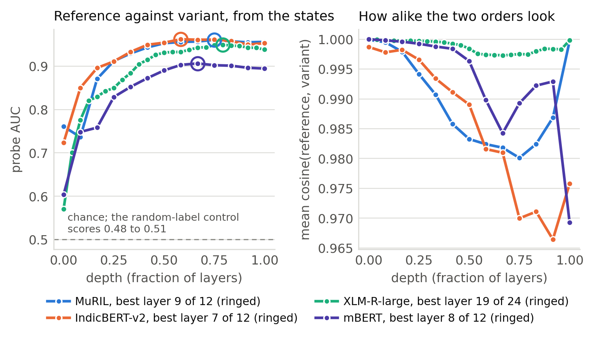
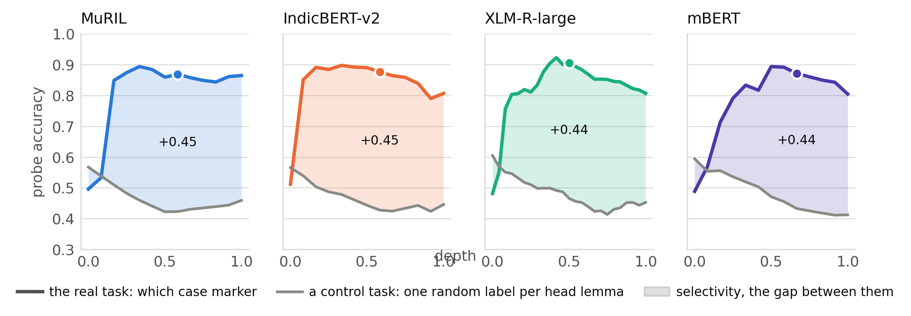
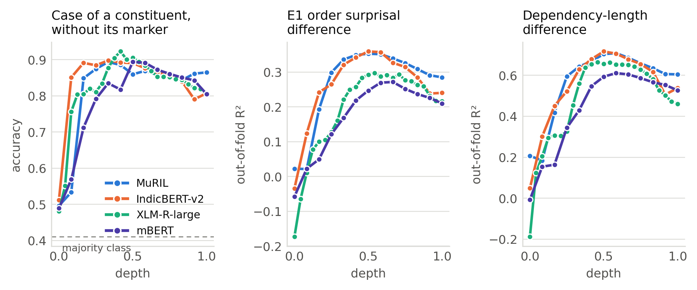
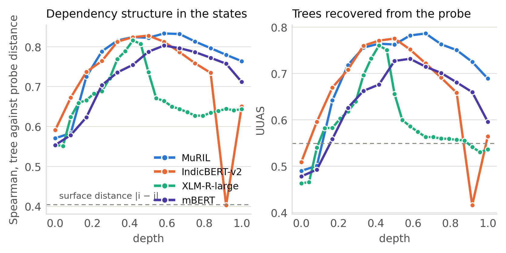
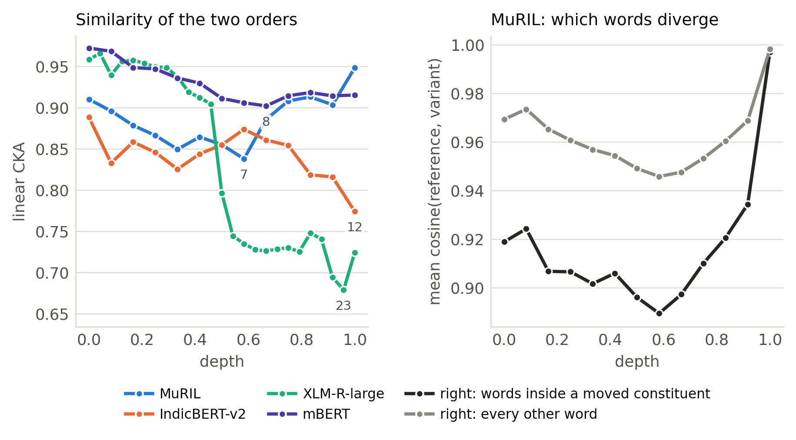
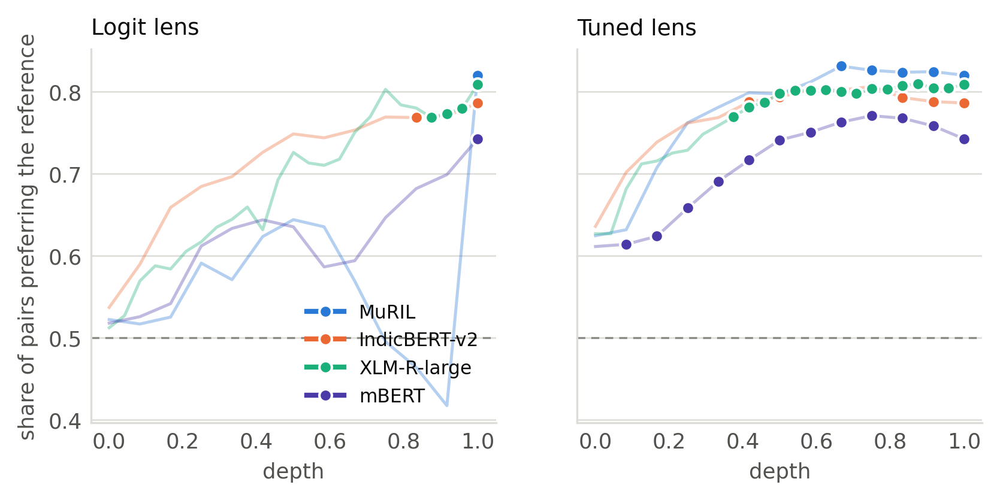
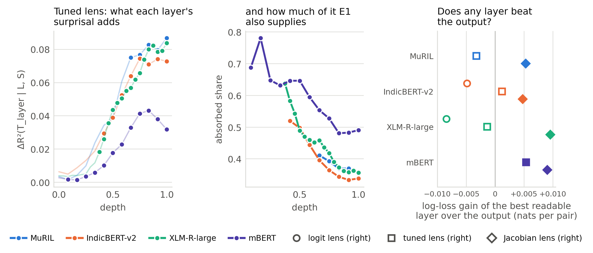
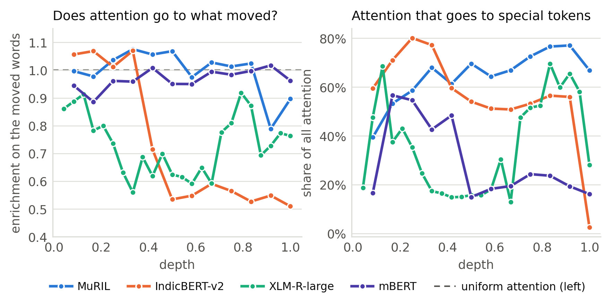
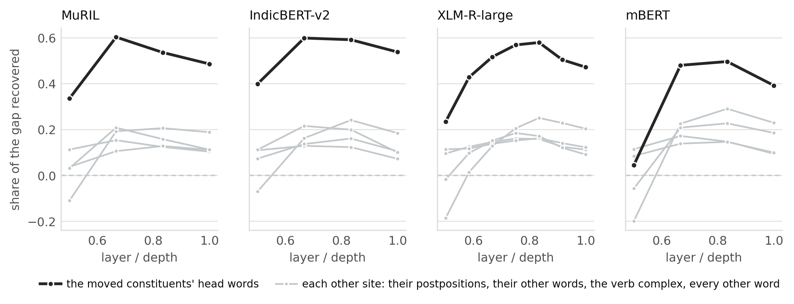
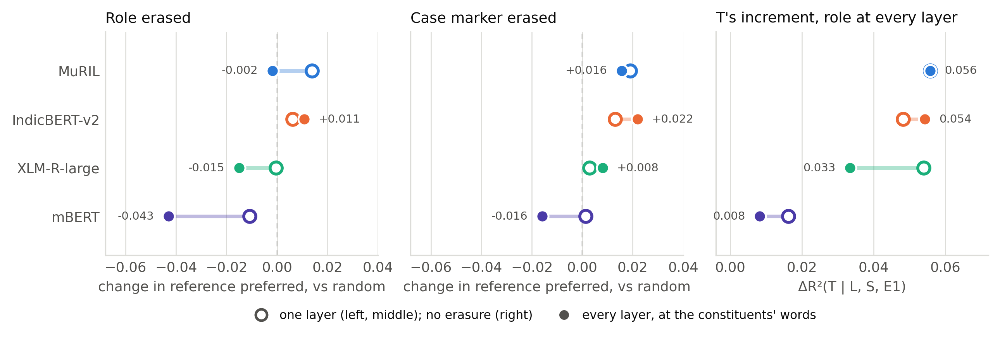

# Earlier layer-wise results (steps 1 to 3)

Results of the authors' earlier layer-wise analysis: the layer analyses (3.11), the interventions (3.20) and the object-agreement behaviour (from 3.21). Every number cites its run record; the records are in `records/`, the figures in `figures/`. Section numbers and cross-references below are those of the earlier write-up.

---

## 3.11 Inside the models: the layer analyses

All four analyses were declared on 15 Sep, before any hidden state was extracted (prereg 7).

**Separability (F1).** `rq1_layer_probe.md`, **figure `f11`**. A logistic probe on the pooled
reference-minus-variant states, 5-fold grouped by reference.

**Figure f11.** *F1. A logistic probe on the pooled reference-minus-variant hidden states separates the two orders best in the upper-middle layers (peak layer marked, depth 0.58 to 0.79), reaching AUC 0.96 for the Indic encoders, as high as the whole four-block classifier with surprisal (0.959 to 0.962). Before the embedding LayerNorm the two orders pool to the same vector (largest difference below 1e-6), an identity check, and a random-label control scores 0.48 to 0.51. Right: the same states' cosine similarity is lowest at layer 9 of MuRIL, 11 of IndicBERT-v2, 16 of XLM-R-large and 12 of mBERT, against the probe's peak at layer 9 of MuRIL, 7 of IndicBERT-v2, 19 of XLM-R-large and 8 of mBERT.*
| model | layer 0 AUC | best layer | best AUC | random-label control |
|---|---|---|---|---|
| MuRIL | 0.760 | 9 of 12 | 0.960 | 0.50 |
| IndicBERT-v2 | 0.723 | 7 of 12 | 0.962 | 0.49 |
| XLM-R-large | 0.570 | 19 of 24 | 0.949 | 0.49 |
| mBERT | 0.603 | 8 of 12 | 0.906 | 0.51 |

The identity check holds, before the embedding LayerNorm the two orders pool to the same vector (largest
difference 9e-08 for MuRIL, 1.2e-07 for mBERT and XLM-R, 4.8e-07 for IndicBERT-v2), so everything above chance at layer 0 comes from how LayerNorm mixes word and
position. **A probe on one middle layer of MuRIL or IndicBERT-v2 matches or slightly exceeds the whole
surprisal-based classifier** (out-of-fold AUC 0.954, 0.950, 0.954, 0.938). The information that separates
the two orders is present in the middle layers as strongly as surprisal plus every baseline expresses it;
whether the model *uses* it in computing surprisal is what the lens addresses.

On the proposal's fixed layer bands (8–12 for 12-layer models, 16–20 for 24-layer): the best layer is
inside the band for three models and one below it for IndicBERT-v2, whose in-band best is 0.0009 lower.
Choosing the layer rather than fixing the band changes nothing.

**Structure (F3).** `rq1_structure_probe.md`, **figure `f12`**. Case marking is recoverable from a
constituent's words **with its own postposition removed**, 0.89 to 0.92 accuracy against a 0.49 control
that already sees the noun's oblique inflection, peaking at layers 4–6 of the 12-layer models and fading
towards the output. Dependency-length difference is strongly decodable (R² 0.61–0.72), the E1 order
surprisal difference moderately (0.27–0.36), both peaking at layers 6–9. **Case information peaks earlier
than order information.**

**And the probe is reading case, not memorising the head** (`rq1_probe_selectivity.md`; O1). An accuracy
of 0.87 means nothing on its own: a probe with enough capacity can reach it by learning which head word
goes with which marker. The project had baselines for that number (majority class, the pre-LayerNorm
control) but not a **control task** in Hewitt and Liang's (2019) sense, which is the check that actually
measures the probe's capacity. Here each constituent's head lemma is assigned one label, drawn once from
the empirical label distribution and fixed for that lemma, so the control task has the same form and the
same label distribution and no linguistic content at all; selectivity is real accuracy minus control
accuracy.

| at the best layer | real | control task | selectivity |
|---|---|---|---|
| MuRIL, layer 7 | 0.869 | 0.423 | **+0.445** |
| IndicBERT-v2, layer 7 | 0.876 | 0.428 | **+0.448** |
| mBERT, layer 8 | 0.872 | 0.433 | **+0.439** |
| XLM-R-large, layer 12 | 0.905 | 0.466 | **+0.439** |

Selectivity is about +0.44 in every model. The control task is never more than 0.20 above its own
majority class (0.40), and that maximum is at the input layer; from layer 4 on it sits 0.01 to 0.13 above
it. So the probe has very little memorisation capacity to spend here, and the case result is about the
states rather than about the probe. Selectivity peaks at layers 7, 7, 8 and 12, the upper-middle band the
pair probes point at; raw case accuracy peaks a little earlier (layers 4, 4, 6 and 10, as F3 says), where
the control task is also higher.

**Figure f33.** *O1. The case probe against a Hewitt and Liang control task, in which each head lemma is given one label drawn from the same distribution, so the task has the same shape and no linguistic content. The filled gap is selectivity, and the marked layer is where it is largest. It is +0.44 to +0.45 across the four models, and at that layer the control task is only 0.02 to 0.06 above its own majority class (0.40), so the probe has little memorisation capacity to spend and the case result is about the states.*
The pair probes are not given a control task and the record says why: they are ridge regressions scored by
**out-of-fold** R² with folds grouped by reference, so capacity spent on memorising shows up as a failure
to generalise rather than as inflated performance. A label-permutation floor is reported beside them to
confirm that it lands at or below zero, which it does.

**Figure f12.** *F3. What the states carry, layer by layer. Case marking is recoverable from a constituent's words with its own postposition removed (peak accuracy 0.89 to 0.92 against a majority class of 0.41), peaking in layers 4 to 6 of the 12-layer models and fading towards the output. How far the constituents moved (dependency length) is strongly decodable (peak R² 0.61 to 0.72) and the structural expectation E1 measures moderately so (0.27 to 0.36), both peaking a little later, in layers 6 to 8 of the 12-layer models, near the reference-variant probe's peak (layers 7 to 9).*
**Dependency structure (F5).** `rq1_word_state_probes_*_f5_norm.md`, **figure `f13`**. A Hewitt–Manning
distance probe on 2,000 references, split by document. Against a surface-distance baseline of 0.404
Spearman / 0.549 UUAS and an embedding control of 0.55 to 0.59 / 0.47 to 0.51, each model's best layer
reaches 0.803–0.833 Spearman and 0.732–0.782 UUAS (MuRIL's highest UUAS, 0.786, is one layer later), peaking in the same upper-middle layers and falling towards the output.

**Figure f13.** *F5. A Hewitt-Manning distance probe on 2,000 references, states scaled by their mean norm. Dependency structure is recoverable well above the surface-distance baseline (dashed, Spearman 0.404), peaking at depth 0.42 to 0.58 (Spearman 0.80 to 0.83) and falling towards the output in every model. IndicBERT-v2's layer 11 (0.402, against the baseline's 0.404) is the one exception, diagnosed in the record and left unexplained rather than tuned away.*
IndicBERT-v2's layer 11 is the one exception: the probe falls to the surface baseline there. Two
diagnostics rule out the obvious explanations: it is not the input scaling (worst under all three) and
not a few dominant dimensions (removing the five highest-variance dimensions changes nothing, and layer
12, which is far more concentrated, probes fine). The information is present at that layer (F1 AUC 0.949).
The remaining explanation is the probe's optimisation there, and testing it would mean tuning the
optimiser for one layer after seeing the result. **It is recorded as unexplained rather than tuned away.**
Nothing in RQ1 depends on it.

**Similarity (F6).** `rq1_word_state_probes_*.md`, **figure `f14`**. Linear CKA between the matched words'
states falls to its minimum in the upper half of every model (MuRIL 0.838 at layer 7, mBERT 0.902 at 8,
XLM-R 0.679 at 23, IndicBERT-v2 0.774 at 12, its output layer); for MuRIL and mBERT that is where the
probes read most, and words inside moved constituents diverge more than the rest, except in
XLM-R-large's upper half, where the divergence is global. This describes where the difference lives, not
that the model uses it.

**Figure f14.** *F6. Token-aligned linear CKA between the reference's and the variant's states. The two orders are represented most differently (CKA minimum, layer marked) at layer 7 of MuRIL, 12 of IndicBERT-v2, 23 of XLM-R-large and 8 of mBERT; the reference-variant probe peaks at layer 9 of MuRIL, 7 of IndicBERT-v2, 19 of XLM-R-large and 8 of mBERT. Right, for MuRIL: at every layer the words inside the moved constituents diverge more than the rest, so the divergence is carried by them, not spread over the sentence.*
**The lens (F2, F4).** `rq1_lens_analysis*.md`, `rq1_tuned_lens_*.md`, **figure `f15`**. Under the declared
readability rule (within 2 nats per subtoken of the final layer on held-out IndicCorp text), the **logit
lens** makes only the last layer readable for MuRIL and mBERT. The **tuned lens** opens most of the depth
(mBERT from layer 1, IndicBERT-v2 from 5, MuRIL from 8, XLM-R from 9). Where the whole range is visible
(mBERT) the preference for the reference grows steadily with depth, 0.61 at layer 1, 0.74 at 6, 0.77 at
9–10; for MuRIL and IndicBERT-v2 it is already at its final level by the first readable layer, and XLM-R
reaches 90% of it one layer after its first readable one. Reading by word class, the preference on the
verb complex appears latest in mBERT (layer 9) and XLM-R (layer 20); in MuRIL the postpositions are
latest (layer 10), and in IndicBERT-v2 the words outside the clause (layer 9).

**Figure f15.** *F2 and F4. Reading the preference out of each layer. Filled markers are layers that pass the declared readability rule (within 2 nats per subtoken of the final layer on 500 held-out IndicCorp sentences); the faint line shows the unreadable layers for context. The logit lens makes almost nothing readable below the output (0 to 3 layers per model); translators trained for the tuned lens open 38 to 92% of the layers, and where the whole range is visible (mBERT) the preference grows steadily with depth to layer 9 (0.77) and falls back to 0.74 at the output.*
**Surprisal read from every layer (M1).** `rq1_layerwise_decomposition_tuned.md`,
`rq1_layerwise_decomposition_logit.md`, **figure `f32`**. Everything above measures the *representation*
and the decomposition measures the *behaviour*, so "the representation has it and the behaviour spends it"
has been an inference across two currencies. Following Kuribayashi et al. (TACL 2025), each layer's lens
surprisal is entered as T in the same four-block model, which puts both on one scale. No rescoring was
needed: the per-word lens columns already exist.

Under the **tuned lens**, two things appear.

| model | readable layers | ΔR²(T \| L,S) at the output | best readable layer | its ΔR² | absorbed share, first readable → output |
|---|---|---|---|---|---|
| MuRIL | 8–12 | 0.0867 | 12 (the output) | 0.0867 | 0.41 → 0.36 |
| IndicBERT-v2 | 5–12 | 0.0727 | 9 | 0.0743 | 0.52 → 0.34 |
| mBERT | 1–12 | 0.0318 | **10** | **0.0431** | 0.69 → 0.49 |
| XLM-R-large | 9–24 | 0.0837 | 24 (the output) | 0.0837 | 0.64 → 0.36 |

First, **the absorbed share falls from the first readable layer to the output in every model**, though
not monotonically (mBERT's rises from layer 1 to 2): surprisal read deeper is less explainable by a
structure-only order model. Second, **mBERT's layer 10 adds 36% more than mBERT's own output** in ΔR²(T | L,S) (0.0431
against 0.0318; in ΔAUC over L+S+E1, +0.0062 [+0.0046, +0.0077] against +0.0042), which would be the representation-behaviour
dissociation measured behaviourally, and in the model whose behaviour is weakest.

Under the **logit lens** the best layer is the output for all four models, with no intermediate peak
anywhere, and that lens makes almost nothing else readable (layer 12 alone for MuRIL and mBERT, 10–12 for
IndicBERT-v2, 21–24 for XLM-R). The two lenses disagree exactly where the Jacobian-lens work predicts they
should: the tuned lens is trained to map intermediate states onto the output distribution, so it can skip
ahead to the output rather than surfacing what a layer itself carries, and the logit lens cannot arbitrate,
because under the declared 2-nat rule those layers are unreadable for it.

**The Jacobian lens (M4)** (`rq1_jacobian_lens_*.md`, `rq1_layerwise_decomposition_jacobian.md`). It reads a
layer through the model's own average local map to the output, J_ℓ = E[∂h_final / ∂h_ℓ], and is fitted to
nothing. The published lens is for autoregressive models; the masked analogue here is the same-position
Jacobian at masked positions, averaged over 2,000 positions drawn from the tuned lens's training sentences
and read as the first-order expansion around the mean state, h_final ≈ μ_final + J_ℓ (h_ℓ − μ_ℓ). The
published form expands around zero (J_ℓ h_ℓ), which suits pre-LayerNorm models; these encoders are
post-LayerNorm and their MLM head applies a dense layer, a bias and an activation before its LayerNorm, so
that form reads MuRIL's layers at 13 to 15 nats per subtoken, flat across depth, and is the worse of the two
at every layer of every model. Both are in every record, and the choice was made on a 20-sentence MuRIL
smoke test before any full run. The averages are stable: the split-half difference is 0.053 of ‖J‖ or less
at every readable layer. Under the 2-nat rule it makes layers 10–12 readable for MuRIL and IndicBERT-v2,
8–12 for mBERT and 21–24 for XLM-R.

**The test** (`rq1_layer_vs_output.md`). Taking a lens's best layer and reading its bootstrap interval
selects on the outcome with an interval known to be too narrow, so every readable layer before the output,
under every lens, was tested against the output: each entered as T beside L + S + E1 on the same folds, the
per-pair difference in out-of-fold log-loss, a sign-flip permutation p with the flips made by document (932
documents, 10,000 flips), and Holm across the layers of each lens and model.

| lens | MuRIL | IndicBERT-v2 | mBERT | XLM-R-large |
|---|---|---|---|---|
| logit | no readable layer before the output | 10, 11 worse | no readable layer before the output | 21–23 worse |
| tuned | none better; 8, 9, 11 worse | none better; 5–8 worse | **10, 11 better** (Holm p 0.0011, 0.0072); 1–7 worse | none better; 9–19 and 23 worse |
| Jacobian | 10 better (Holm p 0.033); 11 worse | 10 better (Holm p 0.049) | **10, 11 better** (Holm p 0.0004 each); 8 worse | **21 better** (Holm p 0.0003); 23 worse |

Layers not named do not differ from the output at Holm p < 0.05.

**For mBERT the dissociation is now a result.** Two lenses built in opposite ways, one trained to reproduce
the output and one fitted to nothing, agree that mBERT's layer 10 predicts the attested order better than
mBERT's own output beyond L + S + E1 (a gain of 0.0054 and 0.0090 nats per pair, ΔAUC +0.0020 and +0.0030,
Holm p 0.0011 and 0.0004), and the logit lens has nothing to say against it, since it leaves no layer of
mBERT before the output readable. Under the Jacobian lens layer 10 adds ΔR²(T | L,S) 0.0511 against the
output's 0.0318, 61% more (the tuned lens says 36%), with almost the same absorbed share (0.479 against
0.490), so what the last two layers lose is not specifically structural. That is the representation and
behaviour dissociation of the layer probes, measured in the decomposition's own currency, in the model whose
behaviour is weakest.

**For the other three it stays lens-dependent.** The Jacobian lens finds one readable layer that beats the
output in each, layer 10 for MuRIL and IndicBERT-v2 and layer 21 for XLM-R, clearly for XLM-R (Holm p
0.0003, ΔAUC +0.0026) and marginally for the other two (Holm p 0.033 and 0.049; 0.032 after
Benjamini–Hochberg over the whole run). The tuned lens finds no layer better than the output in any of
them. So under the one lens not fitted to the output, every model has a readable layer just below the
output that carries something the output does not, and only for mBERT does a second lens agree.

**Figure f32.** *M1 and M4. Surprisal read from every layer by the lens, then entered as T in the same four-block model, so representation and behaviour are measured in one currency. Filled markers are layers the declared 2-nat rule calls readable; the faint line shows the rest. Under the tuned lens the absorbed share falls with depth in every model (rank correlation with depth over the readable layers −0.99 to −0.90; deeper surprisal is less explainable by a structure-only order model), and mBERT's layer 10 adds 36% more than its own output. Right: every readable layer before the output tested against the output, by out-of-fold log-loss with a document-level sign-flip test, Holm within each lens and model; the best layer is shown, filled where it beats the output. The logit lens finds no such layer, the tuned lens only mBERT's, and the Jacobian lens, which is fitted to nothing, one in every model. For mBERT the two lenses agree on layer 10 (gain 0.0054 and 0.0090 nats per pair, Holm p 0.0011 and 0.0004; under the Jacobian lens it adds 61% more ΔR² than the output), so that dissociation is a result; for MuRIL, IndicBERT-v2 and XLM-R-large it rests on the Jacobian lens alone (Holm p 0.0003 to 0.0488).*
**Where the attention goes** (`rq1_attention_mass_*.md`; O4). Everything above says where the order
information *is*. Nothing in this section says which computation puts it there (§3.20 intervenes), and the cheapest step
towards that is to ask whether attention concentrates on the constituents whose position differs between
the two orders. For each of the 2,000 sample references, attention is averaged over heads and over query
positions, giving the share arriving at each subtoken, and the share landing on moved words is divided by
the share of subtokens they occupy. **1.0 is what uniform attention gives.**

| enrichment on the moved constituents | range | peak | where the case probe peaks: selectivity / raw accuracy |
|---|---|---|---|
| MuRIL | 0.79 to 1.08 | 1.076, block 4 of 12 | layer 7 / 4 of 12 |
| IndicBERT-v2 | 0.51 to 1.07 | 1.070, block 4 of 12 | layer 7 / 4 of 12 |
| XLM-R-large | 0.56 to 0.92 | 0.919, block 19 of 24 | layer 12 / 10 of 24 |
| mBERT | 0.89 to 1.02 | 1.017, block 11 of 12 | layer 8 / 6 of 12 |

(Attention is indexed by transformer block, hidden states by the representation each block produces, so
attention in block *i* and hidden state *i* are the same depth. The figure puts both on that axis.)

**Attention never concentrates on the moved material, at any layer, in any model.** No value exceeds
1.08. In two models it goes the other way: IndicBERT-v2 gives the moved constituents only 0.51 to 0.59 of
uniform attention in blocks 6 to 12, and XLM-R-large stays below uniform in every block (0.56 to 0.92).
The peaks for MuRIL and IndicBERT-v2 (block 4) coincide with where raw case accuracy peaks, not with where
selectivity or the reference-versus-variant probe does, and the layers where that probe reaches AUC 0.95
show no concentration at all. Read carefully that is a useful negative: the probe result is demonstrably
not an artefact of attention pointing at the moved words, because attention does not point at them.

One measurement detail is worth stating because a first version of this run, whose output was not kept
as a record, got it wrong. Special tokens
are attention sinks in these models, taking **0.03 to 0.80 of all attention** depending on model and
layer (MuRIL 0.39 to 0.77, IndicBERT-v2 0.03 to 0.80, mBERT 0.15 to 0.57, XLM-R 0.13 to 0.70), and they are
not words. Left in the denominator, they push the enrichment down wherever the sink is large, which reads
as *avoidance* of the moved constituents. The numbers above renormalise over real subtokens,
and the sink share is reported beside them in the records as the diagnostic that explains the difference.

Two limits, both deliberate. This is **reference sentences only**: a variant tree renumbers its tokens in
the new surface order, so recovering which variant word is which reference word means replaying the unit
permutation against the clause spans, which is the kind of index arithmetic that has produced
plausible-looking wrong figures here before. And it is **descriptive**: attention is not explanation, so
this can say that the probes' layers carry no attention signature and cannot say what does cause the
preference. That needs interventions: interchange patching, concept erasure, a distributed alignment search and ablation were run on
2 to 5 Oct (§3.20); causal tracing of the whole computation remains a different paper (`RQ1_WORK_PLAN.md` O5).

**Figure f35.** *O4. Left: attention arriving at the constituents whose position differs between the two orders, divided by the share of subtokens they occupy, so 1.0 is what uniform attention gives. No value exceeds 1.08 at any layer in any model (MuRIL 0.79 to 1.08; IndicBERT-v2 0.51 to 1.07; XLM-R-large 0.56 to 0.92; mBERT 0.89 to 1.02), so attention never concentrates on the moved material by more than 8%, and XLM-R-large never gives it even the uniform share. Right: special tokens take 3 to 80% of all attention and are not words, so the left panel renormalises over real subtokens.*

---

## 3.20 Interventions: patching, erasure and ablation (exploratory, 2 to 5 Oct)

§3.11 reads the layers; these intervene on them. Each script declares its design and a built-in check that stops the
run, and every check passed.

**Interchange patching** (I1; `rq1_patching_<model>.md`, 1,000 pairs per model). Putting the reference's states into one
site of the variant's run, and reading how much of the variant's surprisal gap closes:

| site | MuRIL, layer 8 | IndicBERT-v2, 8 | mBERT, 10 | XLM-R-large, 20 |
|---|---|---|---|---|
| head words of the moved constituents | 0.60 | 0.60 | 0.50 | 0.58 |
| their postpositions | 0.21 | 0.22 | 0.23 | 0.17 |
| their other words | 0.19 | 0.16 | 0.29 | 0.25 |
| the verb complex | 0.11 | 0.14 | 0.15 | 0.16 |
| every other word | 0.15 | 0.13 | 0.15 | 0.16 |

In every model the order preference is carried most by the moved constituents' head words, more than by their
postpositions, the verb or the rest of the sentence, peaking two thirds to five sixths of the way up and falling by
the last layer. (Patching all words at layer 0 recovers the gap exactly, 1.000000, which is the check; early site
patches are strongly negative because at layer 0 a patched state differs only in its position embedding.) This fits
§3.13's lexical anchoring: of what the sites carry in total, the moved head words carry more than their case markers.
That is not a contradiction of §4.2, which found that word for word the postpositions carry the order signal
disproportionately: patching measures a site's total, and a constituent has one head and one or two postpositions,
so the two results measure different things and both hold.

In the other direction (`rq1_patching_<model>_noising.md`), putting the *variant's* states of the moved head words into
the reference's run carries 0.43, 0.45, 0.28 and 0.35 of the gap into it at the same layers (MuRIL, IndicBERT-v2,
mBERT, XLM-R-large), against 0.00 to 0.05 for the verb complex; the check passed for every model. So the head words are
where the preference is carried both ways, and through them breaking it is harder than restoring it (0.28 to 0.45
against 0.50 to 0.60).

**Figure f38.** *I1 (§3.20). The reference's states of one site copied into the variant's run, layer by layer, and the share of the variant's surprisal gap that closes (1,000 pairs per model; patching every word at the embedding layer recovers the gap exactly, the built-in check). Layers below half the depth are left out: near the embeddings a patched state differs mainly in its position embedding and the shares are large and negative (they are in each record). In every model the moved constituents' head words (black) carry the most, peaking at 0.50 to 0.60 two thirds to five sixths of the way up, against at most 0.21 to 0.29 for any other site at the same layer. In the other direction, the variant's head-word states carry 0.28 to 0.45 of the gap into the reference's run at the same layers, the verb complex 0.00 to 0.05.*

**Erasing role and case information** (I2; `rq1_concept_erasure_<model>.md`, `rq1_four_block_erasure_<model>.md`).
LEACE at each model's layer of highest case-probe selectivity removes the linearly decodable role (k1, k2, other) or
case marker at every position while scoring. Each eraser takes its own probe to chance or below while a Hewitt-Liang
control eraser and a random eraser of the same rank leave both probes intact. Against the random eraser, erasing role
changes how often the reference is preferred by +0.014 (MuRIL, p 0.0001), +0.006 (IndicBERT-v2, p 0.04), −0.011
(mBERT, p 0.0012) and 0.000 (XLM-R-large, p 0.89); erasing the marker by +0.019 (p 0.0001), +0.013 (p 0.0006), +0.001 and
+0.003 (both n.s.). **Removing the role and case information a probe finds does not take away the order preference**:
it leaves XLM-R-large's unchanged, slightly strengthens MuRIL's and IndicBERT-v2's, and weakens only mBERT's. So the
case probe's selectivity (§3.11) does not make that information what the preference uses at that layer, with the caveat
that LEACE acts at one layer and later layers can recompute what it removed.

That caveat was put to the test by erasing at every block at once (4 to 5 Oct). The first design
(`rq1_concept_erasure_all.py`; full-fit smoke tests in `logs/i2all_smoke/fullfit*/`, 20 scored pairs each, held-out
readability being what they measure) applied each block's eraser to every token, though it was fitted on the
constituents' pooled states only. It broke the models (held-out nats per subtoken against no erasure; I3's rule reads
nothing more than 2 nats worse):

| first design, every token | MuRIL | IndicBERT-v2 | mBERT | XLM-R-large |
|---|---|---|---|---|
| role (rank 2) | +3.86 | +3.71 | +0.79 | +1.17 |
| case marker (rank 7) | +2.99 | +7.39 | +4.24 | +1.38 |
| a random subspace (rank 2) | +0.15 | +17.0 | +0.51 | +0.17 |

IndicBERT-v2 failing even under the random eraser pointed at the design, not the concepts: LEACE's affine correction is
exact only on the population it is fitted on, and verbs, postpositions, punctuation and [MASK] states are not that
population, so applied to them at every block the corrections compound. The second design
(`rq1_concept_erasure_units.py`, reviewed before its runs; smoke tests in `logs/i2u_smoke/<model>/`) applies each
eraser only to the clause's constituents' own words (without their postpositions) and never to a [MASK] state. Since
the map is affine, erasing every word of a constituent erases its pooled state exactly, and the same exact covariance
check passes at every block. Readability is now measured on 500 held-out treebank references (the units must be
located), and a condition must stay within 2 nats both over all subtokens and over the erased words:

| second design, constituents' words only | MuRIL | IndicBERT-v2 | mBERT |
|---|---|---|---|
| role | +0.10 (erased words +0.14) | +0.08 (+0.11) | +0.24 (+0.34) |
| case marker | +0.09 (+0.14) | +0.07 (+0.11) | +0.20 (+0.29) |
| random | +0.01 (+0.01) | +0.01 (+0.02) | +0.02 (+0.03) |

Every condition is readable, so the second design answers I2's caveat where the first could not; the first design's
damage says nothing about what the models need, since it is explained by where the erasers were applied. The full runs
(`rq1_concept_erasure_units_<model>.md`, `rq1_four_block_erasure_units_<model>.md`; every RQ1 pair, every condition
readable in every model, XLM-R-large's worst +0.23 nats, +0.33 on the erased words) against the one-layer erasure above:

| against the random eraser | MuRIL | IndicBERT-v2 | mBERT | XLM-R-large |
|---|---|---|---|---|
| role, one layer: change in reference preferred | +0.014 | +0.006 | −0.011 | 0.000 (p 0.89) |
| role, every layer | −0.002 (p 0.64) | +0.011 (p 0.003) | **−0.043** (p 1e-4) | **−0.015** (p 8e-4) |
| marker, one layer | +0.019 | +0.013 | +0.001 | +0.003 |
| marker, every layer | +0.016 (p 1e-4) | +0.022 (p 1e-4) | **−0.016** (p 0.002) | +0.008 (p 0.045) |
| ΔR²(T\|L,S,E1), every layer: none / role / marker / random | 0.056 / 0.056 / 0.061 / 0.056 | 0.048 / 0.054 / 0.053 / 0.048 | 0.016 / **0.008** / **0.009** / 0.017 | 0.054 / **0.033** / **0.043** / 0.053 |

For **mBERT and XLM-R-large the caveat was real**: with role kept off the constituents at every layer, so that no later
layer can recompute it there, the reference is preferred less often and T's increment beyond L + S + E1 falls by half
(mBERT) and by two fifths (XLM-R-large), where one layer's erasure had left XLM-R-large unchanged. Erasing the marker
cuts mBERT's increment about as much (0.016 to 0.009, preferred rate −0.016); for XLM-R-large it cuts the increment by a
fifth (0.054 to 0.043) while the preferred rate rises slightly (+0.008, p 0.045), and it lowers XLM-R-large's OSV
defence (−0.053 against random, p 0.0096, 2,286 pairs), the only OSV change in any model. For **MuRIL and
IndicBERT-v2 the one-layer result stands**: the preference does not need role on the constituents at any layer, and
erasing the marker strengthens it. Two caveats. The two designs differ in position as well as in layer: the
one-layer erasure acted at every position, this one only on the constituents' words, so the larger effect comes with
the narrower intervention, not a heavier one. And role erasure costs XLM-R-large 0.23 nats where the random eraser
costs 0.02, so a small general cost is not wholly separable from the concept's; MuRIL and IndicBERT-v2 pay 0.08 to
0.10 and lose nothing.

**Figure f39.** *I2 (§3.20). Left and middle: the change in how often each model prefers the attested order when LEACE removes argument role or the case marker, against a random eraser of role's rank; open dots erase at one layer (every position, the case probe's most selective layer), filled dots at every layer but only on the constituents' own words, where the erasers were fitted. Right: T's increment beyond L + S + E1 without erasure and with role erased at every layer. One layer's erasure moved no model much; at every layer role lowers the preference of XLM-R-large and mBERT (−0.043 and −0.015, sign-flip p 1e-4 and 0.0008) and cuts their increment by 49% and 38%, while MuRIL's and IndicBERT-v2's do not fall. Every condition stays within 2 nats of the unerased model on held-out text; role erasure costs XLM-R-large 0.23 nats, so a small general cost is not wholly separable from the concept's.*

**A distributed alignment search at the moved head words** (I4; `rq1_das_<model>.md`; the learning rate, 1e-3, was a
judgement on a 300-pair MuRIL pilot, made on its validation pairs only, `logs/das_smoke/`: at 1e-3 rank 1 was still
rising where at 1e-2 it had stalled, though 1e-2 was ahead at rank 16, 0.39 against 0.35). DAS learns a rank-k subspace of the moved head words' states at I1's peak layer, trained on
2,000 pairs from documents with no evaluation pair, and interchanges only that subspace from the reference's run into
the variant's. On I1's own 1,000 pairs (the base, clean and full-state runs reproduce I1 per pair, to 1.4e-5 bits at most):

| share of the gap recovered | MuRIL | IndicBERT-v2 | mBERT | XLM-R-large |
|---|---|---|---|---|
| rank 1 | 0.26 | 0.35 | 0.12 | 0.18 |
| rank 16 | 0.56 | 0.63 | 0.42 | 0.44 |
| rank 64 | 0.65 | 0.71 | 0.49 | 0.56 |
| the full state (I1) | 0.60 | 0.60 | 0.50 | 0.58 |
| random subspace, rank 64 | 0.07 | 0.07 | 0.07 | 0.05 |
| verb complex, learned rank 16 (site control) | 0.15 | 0.20 | 0.12 | 0.17 |
| verb complex, the full state (I1) | 0.11 | 0.14 | 0.15 | 0.16 |

Every learned subspace beats a random one of its rank (document sign-flip p 1e-4, except mBERT's verb at rank 1). But
the site control partly fires: for MuRIL and IndicBERT-v2 a learned subspace recovers more than the whole state it
lives in (the verb at rank 16, the moved heads at rank 64), the interpretability illusion of Makelov et al. (2024), so
the absolute DAS shares are upper bounds and are not read as what the state carries. What survives is the contrast
between the sites, 2.6 to 18 times as much at the moved heads as at the verb at the two ranks fitted at both (1 and
16), and the reading of the rank-1 variable: its
change between the two orders tracks how far the moved heads' word positions changed (Spearman over documents −0.83,
−0.67, −0.66 for MuRIL, IndicBERT-v2 and XLM-R-large, +0.39 for mBERT, whose sign is fixed by a near-zero correlation
with its own preference), and hardly E1's order-model difference or the trigram's (|ρ| at most 0.13). So the most
useful single direction at the moved heads says where the word stands, not whether the order is canonical: no
canonicality or agent-first variable was found.

**Mean-ablating mBERT's last blocks** (I3; `rq1_late_ablation_mbert.md`, `rq1_four_block_late_ablation_mbert.md`).
§3.11 found mBERT's layer 10 above its output under two lenses. Replacing block 12's attention output by its mean makes
mBERT both a better masked model of held-out Hindi (0.11 nats per subtoken lower) and a better predictor of the
attested order (reference preferred 0.743 to 0.783; T's increment beyond L + S + E1 0.0162 to 0.0237, and significant
within that condition, McNemar BH p 0.0017, where it is not without ablation, 0.097); block 11's attention does the
same, less, and the MLPs the opposite. That locates the loss §3.11 measured in mBERT's
late attention. One model, and no test of the difference between conditions was declared.

---

## From section 3.21: object agreement under reordering

**Object agreement under reordering** (V3; `rq1_agreement_order_build.md`, `rq1_agreement_order.md`). In an ergative
clause the verb agrees with an unmarked object, never with the ne-marked subject. For 459 Training clauses whose subject
and object differ in gender or number, the attested order and up to 30 of its Set 1 reorderings (5,265 orders) were
scored with the attested verb forms and
with every agreeing verb word switched to the subject's gender and number (Training-attested forms only; only those
words differ, checked). The three strong models prefer the correct agreement in 94 to 96% of orders, mBERT in 64%.
Whether an intervening ne-marked subject pulls a model toward the wrong form was tested on orders whose object is the
same number of words from the verb (102 clauses): **MuRIL is pulled** (its agreement margin falls 1.75 bits when the
subject intervenes, p 0.0001), **IndicBERT-v2's** weakening in such orders is distance (−1.25 bits unmatched, −0.38 and
not significant matched), and **XLM-R-large is not detectably pulled** (−0.21, p 0.58), as agreement that respects case
predicts. The attested orders are almost all of the SOV type (21 of 459 OSV), so this contrasts generated orders.

---

